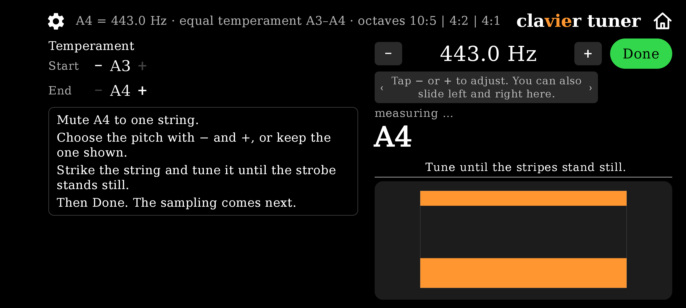
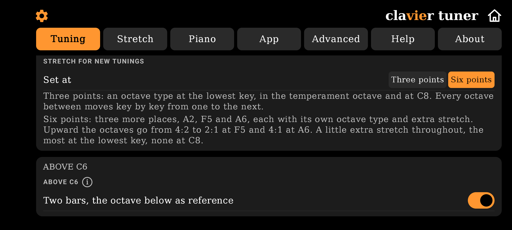
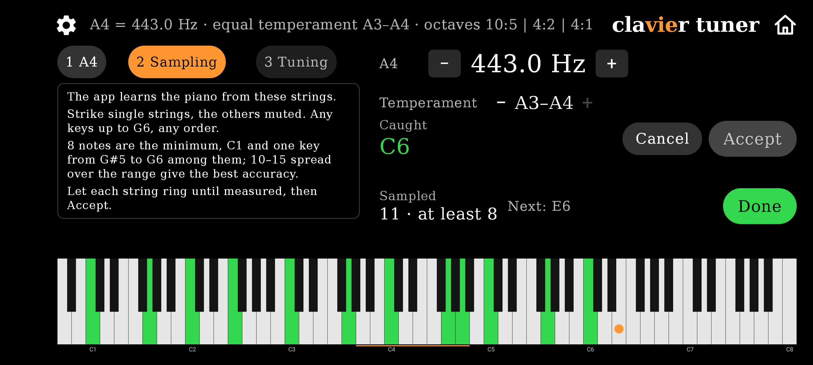
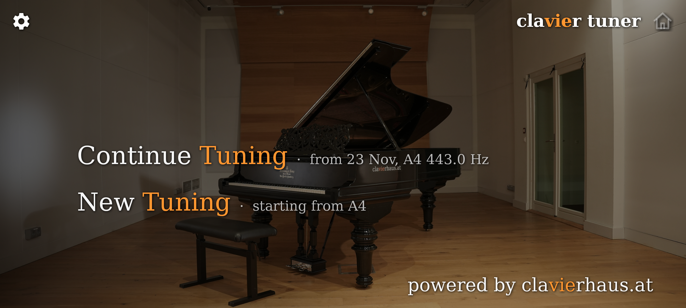
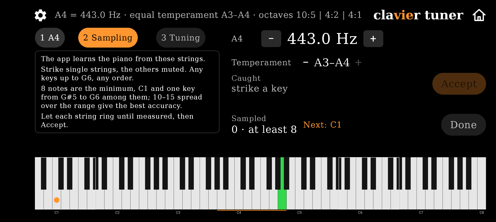

# Clavier Tuner

**A free, open-source piano tuning app.**

Clavier Tuner measures the piano in front of you and tunes it from that
measurement. It listens through the phone's microphone with every effect
switched off, reads each string by phase against a target built from this
piano's own inharmonicity, and keeps everything on the phone — no account, no
server, nothing uploaded. As accurate as the devices you know, and open for
anyone to check how.

Made by [clavierhaus.at](https://clavierhaus.at), a recording studio in Vienna whose main instrument is an
1887 Steinway D, by someone who wanted to see what his instruments actually do.

  

  
  

  
  

## Quickstart

Clavier Tuner is a free, open-source tuning app for piano tuners. A short sampling of 8–15 notes measures your
piano's own strings, and from that measurement the app computes a stretched tuning for exactly this instrument.
No account, no tracking: nothing is recorded or sent.

**Getting started:** tap New Tuning. Mute A4 to one string, choose its pitch, tune the string until the strobe
stands still, then Done. Then sample: strike single strings with the others muted, any keys up to G6, in any order.
Let each string ring until it says measured, then tap Accept. Eight keys are the minimum, C1 and one from G#5
to G6 among them; 10 to 15 spread from the
low bass to G6 give the best accuracy. Before your first tuning, look at the octave types under Settings › Stretch.

**Tuning:** the screen follows the key you strike and shows its target. The temperament comes first. When the
strobe stands still within your tolerance the note is kept; there is nothing to tap. For each new piano, start a
New Tuning; Continue is only for the piano you sampled. Settings › Help has the quick start.

## What it does

- **Sets A4 on the string you choose.** The first page sets the pitch: tap
  − or + (hold to run on), or slide a finger along the strip under them.
  Strike the one string of A4 left unmuted and tune it until the strobe
  stands still, then Done. The same page sets the temperament: where it
  starts (C3 to A3, A3 by default) and where it ends (A4 to C5, A4 by
  default).
- **Measures first.** Strike single strings, mutes in, any keys up to G6 in
  any order: eight are the minimum, C1 and one from G#5 to G6 among
  them, and 10 to 15 spread up to G6 give the best result.
  From those strings the app measures the inharmonicity of the piano and
  computes where every note belongs before you tune the first one. The
  stretch comes from this instrument, not from a table. Each key says
  "measuring …" until more sound no longer changes the measurement, then
  "measured"; the key kept stands green on the keyboard. Above G6 a string's
  inharmonicity does not repeat from strike to strike, so the sampling stops
  there; the tuning does not.
- **Suggests the bass's octave type from your sampling.** Sample two bass
  keys an octave apart, A1 and A2 say, and the window behind the tuning line
  says which octave type they suggest, and why. One tap uses it; the choice
  stays yours.
- **Follows the key.** Strike a note and the screen is on it — the key is
  identified by fitting a string to what the microphone hears, not guessed
  from the loudest peak. Tap the note's name to choose a key by hand.
- **Tunes by the strobe.** For every note the app picks the partial a tuner
  would listen to in that register, synthesises its target, and shows the
  string against it as a strobe, to a tenth of a cent, about 47 readings a
  second. Beside the strobe, three ways of showing it: *One strobe* (the
  default), one band moved by the string's clean partials together; *Limit
  to*, the lowest few partials, a band each; *All partials*. With bands for
  several partials a clean string is one pattern that comes to a standstill,
  and a false partial is the one out of step. Under the strobe the string's
  partials: a tap takes one out of the reading for that note, another brings
  it back. From C6 up the strobe moves at the pin's pace: it slows as the
  strings get shorter, by an amount taken from the piano's own inharmonicity,
  so a turn of the pin looks alike on every key.
- **Reads the top two octaves strike by strike, an experiment.** From C#6
  up, where strings ring for half a second, the strobe gives way to two bars.
  Each strike gives one value, the string's pitch over its loud part, held on
  the bar until the next strike with the change from the one before; a turn
  of the pin shows on the next strike. The left bar is the key an octave
  below as tuned, and the key's target is set from it by the treble's octave
  type. Settings › Tuning › Above C6 brings back the strobe, for every
  tuning.
- **Shows the tuning at a glance.** A line at the top says what this tuning
  is tuned to — A4, the temperament, the octave types. A tap on it opens
  those settings.
- **Knows when the note is in.** When the strobe stands still inside the
  tolerance you set, the app keeps the note, and Progress shows the tuning
  as it stands on the keyboard.
- **Keeps the session.** One sealed file on the phone, under a key that never
  leaves it. Continue tomorrow where you stopped.
- **Carries your choices as settings.** A new phone starts on the six-point
  stretch: octave types and widths at the lowest key, A2, next to the
  temperament, F5, A6 and C8, every octave between moving key by key from one
  place to the next, so the tuning curve has no break anywhere. The
  three-point stretch is one tap away, and every type and width stays yours.
  Each register offers the types its strings sound — bass 4:2, 6:3, 10:5;
  middle 2:1, 4:2; treble 2:1, 4:2, the double octave 4:1 and the twelfth
  3:1. Also the tolerance. The range is the 88 keys, A0 to C8. The
  measurement decides the rest.
- **Explains itself in one place.** Settings › Help: a quick start through a
  tuning, in English and German.
- **Out of the way when you want it.** The phone's Back and Home buttons show
  everywhere but on the tuning screen, which has the whole screen; Settings ›
  App › Display switches them off for a full screen everywhere.

**Out of scope by design:** pitch raises — a piano far from pitch needs one
first. Unisons are tuned by ear.

## What's new

Since 0.9.0, in the next release:

- **Setting A4 shows one band**, A4's first partial against the pitch chosen.
- **The sampling reaches both ends.** Done waits for C1 (or another key of
  the lowest octave) and one key from G#5 to G6. They matter more than the
  count: without them the curve guessed the bass from the middle and on one
  piano missed by hundreds of cents, and eight keys with them did better
  than fifteen without.
- **The temperament's start and end** are set on the A4 page: the start from
  C3 to A3, the end from A4 to C5.

In 0.9.0:

- **The bass's octave type, suggested by your sampling** (above).
- **The six-point stretch is where a new phone starts.**
- **The strobe moves at the pin's pace in the treble** (above).
- **The false-beat check has moved to Clavier Tuner Pro.**

Every change of every version, dated: [`CHANGELOG.md`](CHANGELOG.md).

## How it measures

The chain every proven tuning device uses, written down and testable:

1. **The key** is identified by fitting a string — fundamental and
   inharmonicity — to the peaks the microphone hears (`tuning/KeyIdentifier`).
2. **The partial** is chosen by register (`measure/PartialMap`).
3. **The target** is synthesised from the reference and the instrument's
   measured inharmonicity (`tuning/InharmonicityCurve`, `tuning/TuningSession`):
   octaves chained outward from the temperament, each blended by key from the
   middle's octave type to the outer one, each partial where this piano's
   strings put it; the inharmonicity is one smooth line through the strings
   measured.
4. **The reading** is the phase of that partial against the target
   (`measure/PhaseReader`), shown only while the partial stands over the noise
   beside it. The clean partials are read together, a partial that beats on
   its own is named and left out (`measure/CleanReading`, `measure/BeatMeasure`).
5. **The string** is measured from the strike — every partial, and the fitted
   inharmonicity — and kept (`measure/StringMeasure`).

Raw 48 kHz PCM, the microphone unprocessed; no third-party DSP; the same code
on every platform. The engine is judged against recordings: the core tests
run on synthetic strings, the recording tests on recordings of real pianos. The
engine (`shared/`) and the screens (`ui/`) are one Kotlin Multiplatform
library, the same code on Android and on the iPhone. The Android app is
released; the iPhone app is in testing.

## Install

- **F-Droid**: *Clavier Tuner* (`at.clavierhaus.claviertuner`). A new
  version reaches F-Droid some days after its GitHub release, once F-Droid
  has rebuilt it.
- **GitHub releases**: the signed APK of every version, the same bytes
  F-Droid builds and verifies.

The build is reproducible: F-Droid rebuilds every release from the tagged
commit in its own environment and publishes it only when the bytes match.

Android 8.0 (API 26) or later. The app needs the microphone and nothing else.

## Contributing

- **Issues** with a recording attached are worth ten without. The engine
  hears nothing but the microphone, and the app records nothing — so a
  recording made beside it (a recorder app, 48 kHz, uncompressed, every
  effect off) is the only way anyone else can hear what it heard.
- **Languages.** Every word the app shows lives in `i18n/strings.tsv`, one
  column per language; `scripts/i18n.py --check` refuses holes.
- **Words.** The app speaks the technician's words; `docs/GLOSSARY.md`
  decides each one once, with its source.
- **Measurement.** A change to what is measured or how is a change to the
  documents it is judged by, in the same commit, with the recording that
  called for it.

## Licence

Apache License 2.0 — see `LICENSE`. The typeface is DejaVu Serif (Bitstream
Vera licence); the settings icon is from Material Design icons (Apache 2.0).
