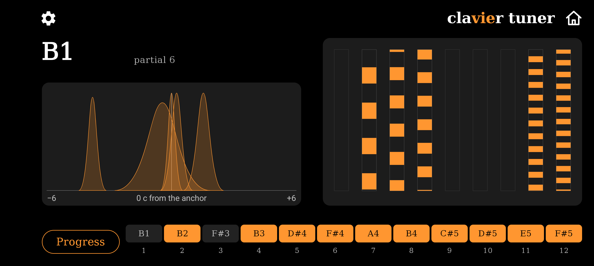
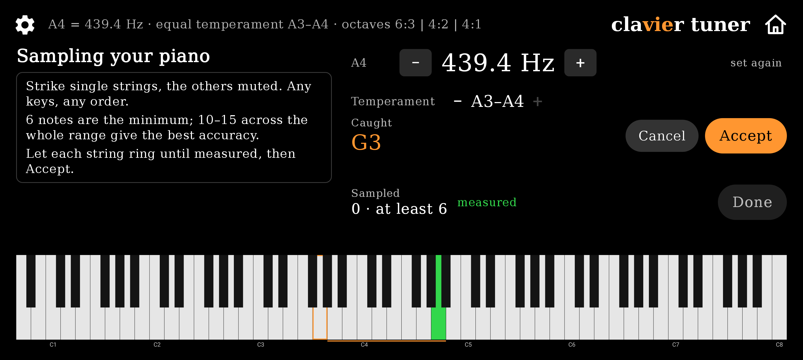
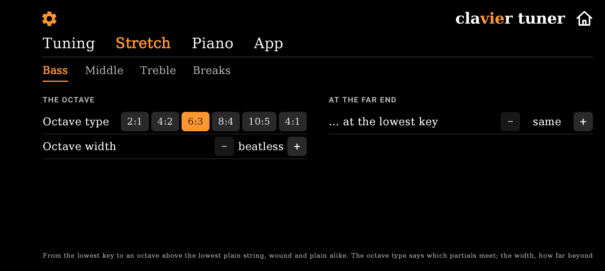
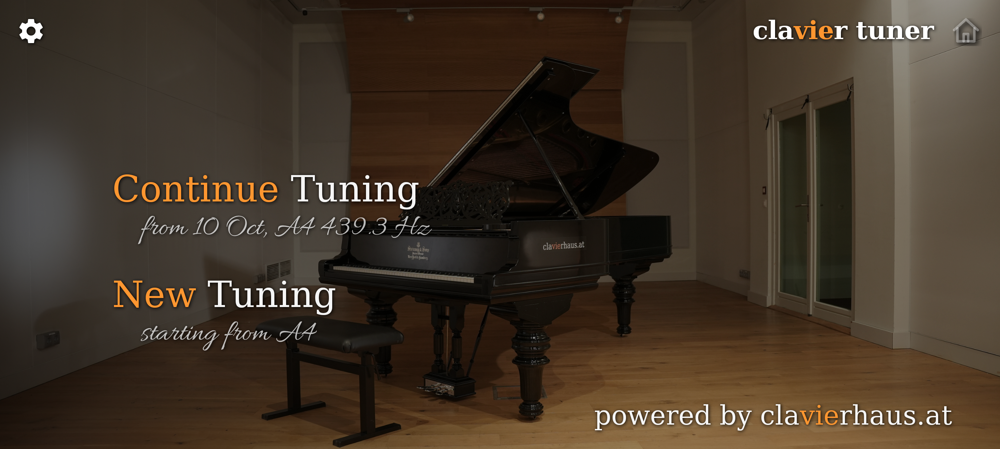
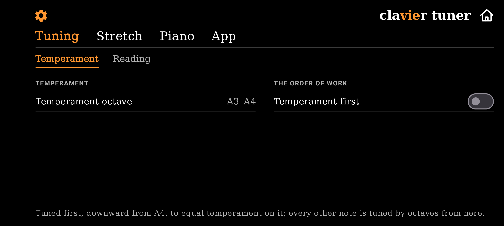

# Clavier Tuner

**A free, open-source piano tuning app, made by a piano tuner.**

Clavier Tuner measures the piano in front of you and tunes it from that
measurement. It listens through the phone's microphone with every effect
switched off, reads each string by phase against a target built from this
piano's own inharmonicity, and keeps everything on the phone — no account, no
server, nothing uploaded. As accurate as the devices you know, and open for
anyone to check how.

Made by [clavierhaus.at](https://clavierhaus.at), Vienna, by a piano tuner who
wanted to see what his instruments actually do.

  

  
  

  
  

## What it does

- **Measures first.** Strike a handful of keys, single strings, mutes in. From
  those strings the app measures the inharmonicity of the piano and computes
  where every note belongs before you tune the first one. The stretch comes
  from this instrument, not from a table.
- **Follows the key.** Strike a note and the screen is on it — the key is
  identified by fitting a string to what the microphone hears, not guessed
  from the loudest peak. Measured on recordings of six pianos (Bösendorfer
  225 and 290, Steinway B and D, Kawai, Samick): 49 of 49 keys of a walk
  across the compass, 169 of 173 on the largest corpus.
- **Reads the way a tuner listens.** For every note the app picks the partial
  a tuner would listen to in that register, synthesises its target, and shows
  the string against it as a strobe, to a tenth of a cent, 47 readings a
  second. A string that wobbles is shown wobbling; nothing is smoothed into a
  verdict.
- **Shows every partial.** Beside the strobe stand the bells: each partial of
  the string read on its own against the string's own model. A clean string
  reads as one stack; a false beat is seen for what it is.
- **Knows when the note is in.** When the strobe stands still inside the
  tolerance you set, the app records the note and the keyboard shows the
  tuning as it stands. No Done to tap.
- **Keeps the session.** One sealed file on the phone, under a key that never
  leaves it. Continue tomorrow where you stopped.
- **Carries your choices as settings.** Octave type and width per register,
  the compass, the wound/plain break, the temperament's reach, the match
  window. The measurement decides the rest.

**Out of scope by design:** pitch raises — a piano far from pitch needs one
first. Unisons are tuned by ear.

## How it measures

The chain every proven tuning device uses, written down and testable:

1. **The key** is identified by fitting a string — fundamental and
   inharmonicity — to the peaks the microphone hears (`tuning/KeyIdentifier`).
2. **The partial** is chosen by register (`measure/PartialMap`).
3. **The target** is synthesised from the reference and the instrument's
   measured inharmonicity (`tuning/InharmonicityCurve`, `tuning/TuningSession`):
   octaves of the chosen type chained outward from the temperament, each
   partial where this piano's strings put it.
4. **The reading** is the phase of that partial against the target
   (`measure/PhaseReader`), shown only while the partial stands over the noise
   beside it. The clean partials are read together, a partial that beats on
   its own is named and left out (`measure/CleanReading`, `measure/BeatMeasure`).
5. **The string** is measured from the strike — every partial, and the fitted
   inharmonicity — and kept (`measure/StringMeasure`).

Raw 48 kHz PCM, the microphone unprocessed; no third-party DSP; the same code
on every platform. The engine is judged against recordings: the core tests
run on synthetic strings, the corpus tests on real ones, and the findings of
every piano day are written down with the recording they came from. The
engine (`shared/`) and the screens (`ui/`) are a Kotlin Multiplatform library
with an iOS stub; only the Android app exists today.

## Install

- **F-Droid**: *Clavier Tuner* (`at.clavierhaus.claviertuner`) — once the
  first release is through F-Droid's review.
- **GitHub releases**: the signed APK of every version, the same bytes
  F-Droid builds and verifies.

The build is reproducible: F-Droid rebuilds every release from the tagged
commit in its own environment and publishes it only when the bytes match.

Android 8.0 (API 26) or later. The app needs the microphone and nothing else.

## Contributing

- **Issues** with a recording attached are worth ten without. The engine
  hears nothing but the microphone, and the app records nothing — so a
  recording made beside it (a recorder app, 48 kHz, uncompressed, every
  effect off) is the only way anyone else can hear what it heard.
- **Languages.** Every word the app shows lives in `i18n/strings.tsv`, one
  column per language; `scripts/i18n.py --check` refuses holes.
- **Words.** The app speaks the technician's words; `docs/GLOSSARY.md`
  decides each one once, with its source.
- **Measurement.** A change to what is measured or how is a change to the
  documents it is judged by, in the same commit, with the recording that
  called for it.

## Licence

Apache License 2.0 — see `LICENSE`. The typeface is DejaVu Serif (Bitstream
Vera licence); the settings icon is from Material Design icons (Apache 2.0).
